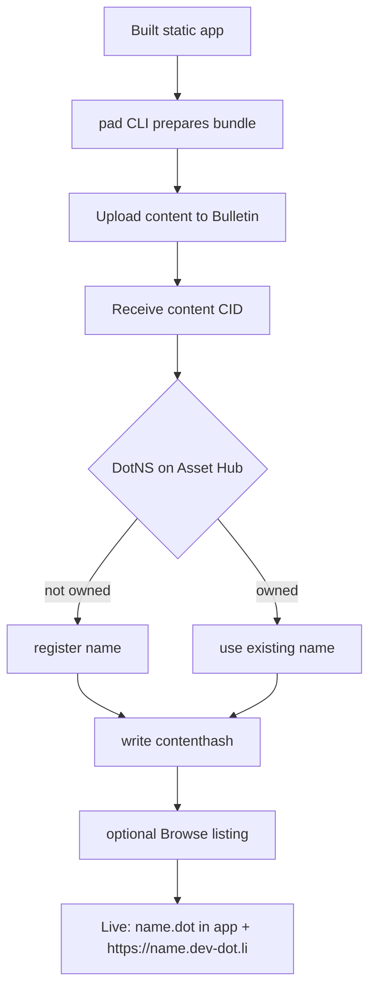
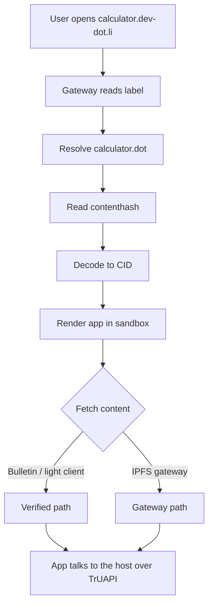

# App delivery

This page follows a built frontend on its way to becoming a live app on the
Polkadot Products Devnet. You publish a static bundle with the `pad` CLI, the
content is stored on the Bulletin chain, a `.dot` domain is bound to it, and
people load it through the `dev-dot.li` gateway or the Polkadot app.

No server sits between a user and an app. The content lives on-chain
(Bulletin), the pointer to it lives on-chain (a `.dot` domain resolver on Asset
Hub), and the loader is a program on the user's device that reads both
directly.

## Publishing and opening

Delivery has a write side (publishing) and a read side (opening). The publisher
uploads a bundle and binds a name to it once. Every visitor then resolves and
fetches that bundle independently.



## Publishing with `pad`

The deploy CLI is [`@polkadot-community-foundation/polkadot-app-deploy`](https://www.npmjs.com/package/@polkadot-community-foundation/polkadot-app-deploy),
which ships the `pad` binary (alongside `polkadot-app-deploy` and
`polkadot-app-bootstrap`). `pad` selects a network with `--env devnet`. Once
your frontend is built, publishing it is a single command over the output
directory:

```bash
pad ./dist my-app.dot --env devnet --mnemonic "$MNEMONIC"
```

The CLI merkleizes the build directory into a content-addressed DAG-PB
archive, chunks it (~2 MiB) and uploads the blocks to Bulletin via
`TransactionStorage.store_with_cid_config`. It then writes the resulting root
CID as an ENS-style `contenthash` (`0xe301` + CIDv1) into the DotNS
`ContentResolver` on Asset Hub. Re-publishing the same app skips unchanged
blocks and updates the name to point at the new content.

### Bulletin storage and upload authorization

Content is stored on the Bulletin chain. Uploads work by authorization, not by
fees: the uploading account needs an upload quota, but does not pay devnet
tokens for each bundle. An authorizer grants the quota via
`authorize_account`. The account that signs the deploy is the one that uploads,
so that is the account that needs the quota.
[Get storage authorization](../guides/build-and-publish.md#get-storage-authorization)
has the practical steps. This is separate from the token
[faucet](../reference/networks.md#faucet), which only provides native tokens
for fees.

The same authorization model applies to every write to Bulletin.
[Storage & data](storage.md#how-storage-authorization-works) explains why
writes are gated, why this Devnet keeps it open, and that authorizations are
finite and expire.

### Binding the `.dot` domain

Once the content CID exists, the CLI checks whether the signer owns the `.dot`
name. If the name is available, it can register it. If the signer already owns
it, the CLI updates the name's content hash. That one on-chain record is what
turns a name into an app. [Naming (DotNS)](naming.md) explains ownership and
resolution.

A deploy config can also publish manifest records. Product apps use those
records to describe executables, labels and icons to the host.

## Opening an app through the gateway

The web gateway at [https://dev-dot.li](https://dev-dot.li) is a loader that
runs in the browser. There is no resolution server: the host shell reads the
label from the subdomain, resolves it, fetches the content and renders it in a
sandboxed iframe.



The rendered app talks to the host through a bridge for accounts, signing,
chain connection and scoped storage. For the user, the same name works in both
places: on the web it is `https://<label>.dev-dot.li`, and in the Polkadot app
it is `<label>.dot`.

## Common blockers

- **Upload fails.** The deploy account may need Bulletin storage authorization.
- **The name cannot be updated.** The signer must own the `.dot` domain.
- **The app opens but has stale content.** Confirm the name's content hash points
  to the latest CID and that the gateway is resolving the expected network.

## Learn more

- [polkadot-app-deploy](https://github.com/Polkadot-Community-Foundation/polkadot-app-deploy): source for the `pad` CLI
- [dotli-community](https://github.com/paritytech/dotli-community): the gateway loader
- [Build & publish an app](../guides/build-and-publish.md): publish one yourself
