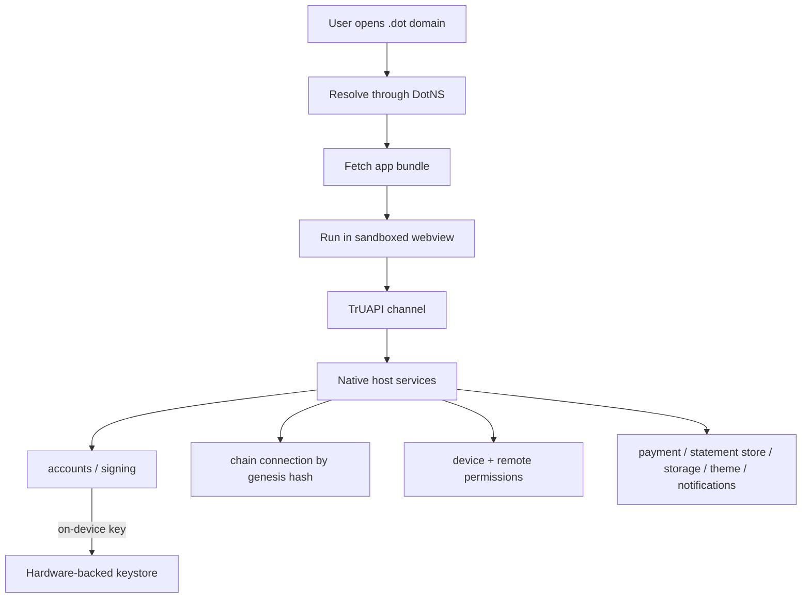
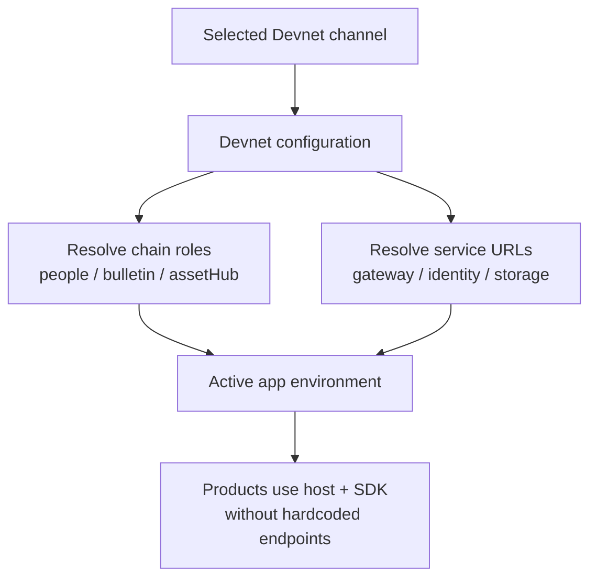

# The Polkadot app (client tier)

The Polkadot app is how people reach the Polkadot Products Devnet. It keeps
keys on the user's device and brings identity, chat, payments and a browser for
`.dot` apps into one app. This page covers the mobile and desktop clients, how
Products run inside them over TrUAPI, and how the app decides which network to
talk to.

## What the clients do

For users, the app is one place to hold keys, manage identity, use CASH,
message other people and open `.dot` apps. For developers, it is the host your
Product relies on for accounts, signing, chain access, permissions and storage.

The native clients share the same features:

| Client | Role |
|--------|------|
| Polkadot Android | Mobile app with local custody, identity, CASH, messaging, and app hosting |
| Polkadot iOS | Mobile app with the same product surface for iOS users |
| Polkadot Desktop/Web | Desktop app and web client for the same account and Product flows |

The Desktop build also runs as a web application, and the same Products are
reachable through the web gateway at [dev-dot.li](https://dev-dot.li). Download
links are in [More resources](../reference/resources.md).

## Wallet and account management

On mobile (Android and iOS), accounts are created and stored on the device, and
the app is self-custodial. Keys are held in the platform's hardware-backed
secure storage (the Android keystore, or the iOS Keychain). Recovery goes
through the device's cloud backup: Google Drive on Android, iCloud on iOS.
Signing happens on the phone. When a dApp or an in-app action needs a
signature, the app shows a modal, and the key on the device signs the payload
only after you approve.

The desktop/web client holds no keys of its own. It is a companion: you pair it
with your phone (by scanning a pairing code), and signing happens on the phone.

Nothing funds a new account automatically. On devnet (non-production) builds
you can top up your account with test tokens using the manual "+" (top-up)
action. For native devnet tokens to pay transaction fees, use the faucet at
<https://faucet.polkadot.io>.

Identity, chat and payments each live on specific parachains. The People Chain
carries your username and the chat statement store. Asset Hub carries payments
and the DotNS name registry. The Bulletin Chain serves dApp content and chat
attachments.

## The app browser

The in-app browser finds dApps by `.dot` domain, not by URL. It resolves the
name through DotNS, fetches the referenced content archive from Bulletin or a
gateway, and runs the archive in a sandboxed webview. The app then opens a
TrUAPI channel, through which Products can ask the host for account, signing,
chain, permission, storage, theme, notification, payment and navigation
services.

Each platform embeds the webview in its own native stack, but Products see the
same protocol, TrUAPI, everywhere.

## Running dApps over TrUAPI

Once the webview loads, the Product talks to the host over its TrUAPI channel.
The host decides which capabilities are available, checks permissions and
handles sensitive actions such as signing.

A typical signing flow:

1. The dApp asks the host, over TrUAPI, to sign a payload or raw bytes, or to
   create a transaction.
2. The native side receives the request and checks the product's granted
   permissions.
3. The app shows a signing modal for you to review and approve.
4. On approval the key on the device signs, and the signature goes back to the
   dApp. Broadcasting is gated inside the container.

When you build a Product, you rarely call these primitives yourself. The
[`@parity/product-sdk`](https://www.npmjs.com/package/@parity/product-sdk)
wraps TrUAPI. To test a Product end to end, use the
[test host](../guides/platform-services-sdk.md#test-without-the-real-host) in
[`@parity/truapi-host`](https://www.npmjs.com/package/@parity/truapi-host): it
runs the real TrUAPI core, embeds your product in an iframe, signs in dev
accounts (Alice, Bob) and auto-signs requests.

## Selecting the network

The operators decide which network the app uses. Each client asks for the
roles it needs (`people`, `bulletin`, `assetHub`), then gets the current RPC
endpoints, DotNS contract addresses, gateway URLs and backend URLs from the
Devnet configuration service. For users and app developers, this means
Products are not expected to hardcode any of those values.

If the app cannot resolve a complete environment, it stops instead of
guessing. Developer tools work the same way: the CLIs select a named network
preset, and the preset supplies the chain and registry addresses for that
network.

## Common blockers

- A Product runs outside the host: host-only APIs need the Polkadot app or the
  web gateway. Use the test host for local end-to-end tests.
- A signing request is denied: the user must approve on the device, and the
  Product must have the required permission.
- The app cannot resolve the Devnet: the platform supplies the network
  configuration, and endpoints hardcoded in Product code break easily.

## Learn more

- Client source and downloads: [More resources](../reference/resources.md)
- [Test without the real host](../guides/platform-services-sdk.md#test-without-the-real-host): drive a Product against the TrUAPI test host in CI
- [Naming (DotNS)](naming.md): how the browser resolves a `.dot` domain
