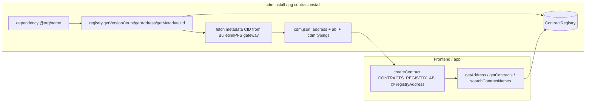

# Smart contracts & CDM

Smart contracts on the Polkadot Products Devnet run on PolkaVM (PVM) through
`pallet-revive` on Asset Hub. You work with them through the Contract
Dependency Manager (CDM): you publish a contract under a package name, and
other apps resolve that name to the current address and ABI.

## What CDM does

CDM handles contracts much like a package manager handles libraries. With it
you:

- Build a contract into PolkaVM bytecode.
- Deploy it to Asset Hub.
- Register it under a package name such as `@org/name`.
- Resolve that name later from an app or another package.
- Install the ABI and generated TypeScript helpers into a frontend.

At runtime, apps make typed calls against these contracts with the
`@parity/product-sdk-contracts` package, which is part of the
[Product SDK](../reference/packages.md#product-sdk-family).

## The Contract Registry

Each network has an on-chain `ContractRegistry`. For each package name it
stores the owner, published versions, contract addresses and metadata pointers.

The first account to publish a name becomes its owner, and only that owner can
publish later versions. Names must match the `@scope/name` shape, be ASCII, and
encode to at most 64 bytes.

The registry address is different on each network.
`@polkadot-community-foundation/cdm-env` resolves it with
`getRegistryAddress(name)`. Apps should read the address for their selected
preset at runtime, for example with `getRegistryAddress("devnet")`, instead of
copying addresses into source or between environments.

## Metadata on the Bulletin Chain

A contract's ABI and documentation are stored as content-addressed metadata on
the Bulletin Chain. The registry stores a pointer to that metadata, and
installers fetch it when they need the ABI.

## Deploying and registering

The `cdm` CLI runs the whole pipeline. `cdm deploy -n <network>` resolves the
network preset, builds the contracts, publishes their metadata to Bulletin,
deploys the contracts to Asset Hub, and registers the package version in the
`ContractRegistry`, which maps each name to its owner, versions and metadata.

To deploy your own contracts:

1. Install the CDM CLI and its Rust toolchain (`cdm setup`). See
   [Deploy & register contracts](../guides/deploy-contracts-cdm.md).
2. Declare dependencies between your contracts in the project metadata, so CDM
   knows the build order.
3. Deploy to your network:

    ```bash
    cdm deploy -n devnet
    ```

4. On a fresh network, the registry must exist before packages can be
   published.

Never print or commit signing seeds. Fund a deploy account from the network
faucet at <https://faucet.polkadot.io>.

## Using a contract: `cdm install`

A project that uses a contract does not need its source, only its name. An
install reads the registry, fetches the metadata by CID, extracts the ABI, and
writes a `cdm.json` manifest plus generated TypeScript augmentation:

```bash
cdm install @org/name
```

The `playground-cli` uses the same approach for playground sessions.

## How a frontend resolves a contract

At runtime an app resolves a name to an address and ABI, then makes typed
calls.



In an installed app, ABIs usually come from `cdm.json` and the generated
helpers, while addresses are resolved from the registry for the target network.

## Shared system contracts

The `contract-developer-tools` repository holds shared PVM contracts deployed
through CDM. Look at it to see how packages declare dependencies and use
contracts installed from the registry.

## Common blockers

- The package name is already owned: the first writer owns the name, and later
  versions must be published by the owner.
- The registry address is wrong: resolve it from the selected network preset
  instead of copying an address between environments.
- Metadata cannot be fetched: check the Bulletin/IPFS gateway and the CID
  stored for the package version.
- The deployment account has no funds: get PAS from the faucet before
  deploying.

## Learn more

- [contract-dependency-manager](https://github.com/paritytech/contract-dependency-manager): CDM source
- [contract-developer-tools](https://github.com/paritytech/contract-developer-tools): shared PVM contracts, and how packages declare dependencies
- [Deploy & register contracts](../guides/deploy-contracts-cdm.md): deploy one yourself
