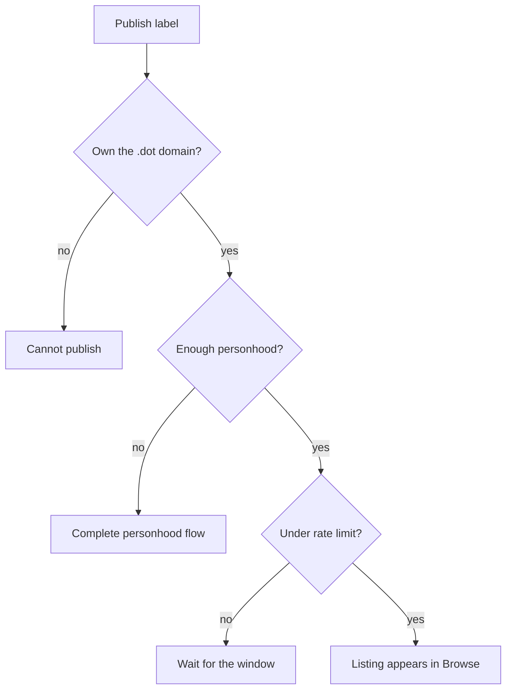
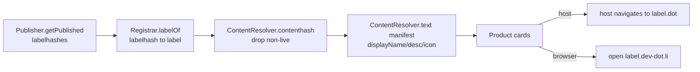

# App discovery: Browse

Browse is the app-discovery directory for the Polkadot Products Devnet. It
tells people which `.dot` apps exist and how to open them, but it is not the
source of truth for app metadata.
The on-chain listing is deliberately small; the user-facing name, description,
and icon are resolved from DotNS records and content storage at read time.

The reference directory runs at [browse.dev-dot.li](https://browse.dev-dot.li),
and its source is in [paritytech/browse](https://github.com/paritytech/browse).

The contracts described here are unaudited prototype code.

## What discovery helps you do

Users use Browse to find apps. Developers use it to make a published app
visible after the app already has a `.dot` domain and a bundle. Browse is not a
replacement for DotNS or app delivery; it sits on top of them.

The system has three responsibilities:

- Registry: records that a `.dot` label should appear in discovery.
- Reader SDK: reads registry entries and joins them with DotNS metadata.
- Client UI: renders cards and opens the selected app in the host or web
  gateway.

## What a listing actually holds

A listing is created by publishing a `.dot` label to the Browse registry. The
registry stores only the minimum needed to enumerate apps. It does **not** store
the display name, description, icon, or app bundle.

All display metadata lives off-chain and is joined by labelhash at read time:

- The human-readable label comes from DotNS.
- The app bundle and display metadata come from the name's resolver records.
- The root manifest provides the card content Browse shows to users.

A valid manifest needs a display name, description, and icon:

```json
{
  "$v": 1,
  "displayName": "Calculator",
  "description": "A basic calculator.",
  "icon": { "cid": "bafy...", "format": "png" }
}
```

## The publish permission model

Who is allowed to list an app is enforced on-chain:

1. You must own the `.dot` domain.
2. You need the required personhood status for the publish action.
3. You must be under the publish rate limit for your personhood tier.

| Personhood status | Meaning | Publishes per 24h |
|---|---|---|
| None | Not enough to publish | 0 |
| Lite | Basic personhood | 1 |
| Full | Stronger personhood | 5 |

Unpublishing is simpler: if you own the name, you can remove it from Browse.



The `pad` deploy CLI no longer lists apps as part of a deploy.

## How a listing is consumed

The client builds the directory from the registry every time it loads:

1. Enumerate: read published labels from the registry.
2. Resolve labels: turn label identifiers back into `.dot` labels.
3. Hydrate: read each name's content hash, manifest, and any available
   attestation or certificate data.
4. Render: build product cards from `displayName`, `description` and the icon
   (fetched through the host's preimage manager, not a raw gateway URL), with
   certificate badges.

Reading the directory needs no signer and sends no transactions. To open an
app, Browse hands off: inside the Polkadot app it asks the host to navigate to
the `.dot` domain, and in a browser it opens the web gateway.



The registry stores only the labelhash, the publisher and a timestamp. So to
change an app's name, description or icon, you don't write to the registry at
all. You update the DotNS `manifest` record, and the directory picks it up on
the next hydrate.

## Common blockers

- **The app has no card metadata.** Update the DotNS manifest record with a
  display name, description, and icon.

## Learn more

- [browse](https://github.com/paritytech/browse): source for the directory and its client
- [App delivery](./app-delivery.md): the pipeline that writes the contenthash and manifest
