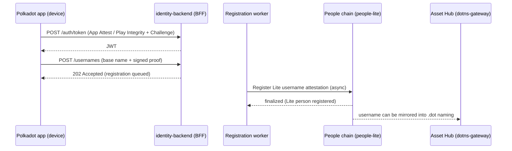

# Identity & personhood

Identity on the Polkadot Products Devnet answers two questions about an
account: what name does it use, and does it belong to a distinct person? The
first is the username flow. The second is proof of personhood. Apps can use
both without holding the user's keys or seeing what the user does in other
apps.

## The moving parts

Identity is spread over a few separately deployed components. The main source
repositories are under [github.com/paritytech](https://github.com/paritytech).

| Component | Role | Source |
| --- | --- | --- |
| `identity-backend` | Stateful HTTP backend-for-frontend (BFF) for the Polkadot app, backed by Postgres (usernames, single-use/revocable refresh tokens, a registration queue, device attestations, and invitation tickets). Issues JWT sessions, registers usernames, manages invitation tickets. Holds no user keys. | [identity-backend-community](https://github.com/paritytech/identity-backend-community) |
| `people-lite` pallet | On-chain registry of *Lite* people (attested usernames) on the People chain. | [individuality-community](https://github.com/paritytech/individuality-community) |
| `proof-of-ink` pallet | On-chain *Full* personhood: applications, invitations, and evidence judging. | [individuality-community](https://github.com/paritytech/individuality-community) |
| `personhood` precompile | A pallet-revive precompile that lets any PolkaVM contract read an account's personhood tier and a per-app alias. | [individuality-community](https://github.com/paritytech/individuality-community) |
| `attestation-protocol` | An EAS-style, permissionless attestation suite (`SchemaRegistry` + `AttestationService`) for general claims. | [attestation-protocol](https://github.com/paritytech/attestation-protocol) |

### The identity backend is centralized today

Every other component above is on-chain. `identity-backend` is not: it is an
operator-run HTTP service with its own database, and the Lite tier depends on
it to attest devices, allocate usernames and submit the registration. It holds
no user keys and cannot sign as a user, but it is a trusted party, and while it
is down, username registration stops.

This is a devnet shortcut. Running this role in a decentralized way is
desirable future work, and the Devnet does not demonstrate it, so don't read
the current setup as the final architecture.

## Sessions: proving the device, not the person

Before a client can register anything, it gets a JWT through a
device-attestation handshake. The backend never sees a password. It checks that
the request comes from a genuine, unmodified copy of the app on a genuine
device.

1. The client requests a Challenge: a stateless, self-authenticating freshness
   nonce that the server mints without storing anything.
2. The client produces an Attestation: Apple App Attest on iOS, Google Play
   Integrity or Android key attestation on Android, or a voucher secret for
   out-of-band enrolment.
3. The client `POST`s the Attestation and the echoed Challenge to
   `/api/v1/auth/token`, and receives a JWT. `/auth/token/refresh` rotates it.

So a session proves the device and the app instance before the backend accepts
identity actions from it.

## Usernames and the Lite tier

A Lite person is an account with an attested, human-readable username. The
client asks for a base name, the backend allocates an available suffixed name,
and the user signs the registration. The backend accepts and queues the request
(returning `202 Accepted`), and a separate worker submits the attestation to
the People chain later. The backend never takes custody of the user's keys or
signs as the user.

Registration has limits. On iOS, Apple DeviceCheck limits the number of free
registrations per device: a device that has already registered gets a
`PAYMENT_REQUIRED` response on further attempts.

Each new username can also be reflected into the `.dot` naming system, so the
same readable identity works across the app and app discovery. Operator-run
infrastructure does that mirroring, and users and Product developers normally
don't interact with it directly.



## Full personhood and invitation tickets

The Full tier is stronger. It represents a person who has completed a
personhood flow, such as an invitation or a game-based proof. The backend can
help users get the tickets or proofs they need to start those flows, but the
status itself is recorded on-chain.

Whether the Full tier is currently active on the deployed devnet depends on
operator-privileged tasks (game scheduling and related runtime configuration).
Treat a `None`/`Lite` result as the safe default, and don't assume Full
personhood is available.

## How apps read identity status

Contracts don't ask the backend about personhood. Personhood state is reflected
from the People chain to Asset Hub over XCM, and PolkaVM contracts read it there
through the personhood precompile:

```solidity
struct PersonhoodInfo { uint8 status; bytes32 contextAlias; }

// status: 0 = None, 1 = Lite, 2 = Full
function personhoodStatus(address account, bytes32 context)
    external
    view
    returns (PersonhoodInfo memory);
```

The returned `contextAlias` is a per-application pseudonym that protects the
user's privacy. The same person gets a different alias in a different context,
so apps cannot link a user's activity across applications.

Front-ends that run inside the Polkadot app or the web gateway at
[https://dev-dot.li](https://dev-dot.li) get identity and host information
through the developer packages:
[`@parity/product-sdk`](https://www.npmjs.com/package/@parity/product-sdk),
which talks to the host over TrUAPI
([`@parity/truapi`](https://www.npmjs.com/package/@parity/truapi)). Their own
repositories define exactly what those packages expose for username and
personhood status.

## General attestations

Beyond personhood, the attestation protocol provides reusable claim and schema
contracts on the PolkaVM Asset Hub. Use it when an app needs verifiable claims
that are something other than username or personhood status.

## Common blockers

- The device session is missing or expired: the app must complete device
  attestation before identity actions can go ahead.
- The username is taken: the backend allocates a suffixed name that is still
  available.
- Full personhood is not available in a build: treat `None` or `Lite` as the
  safe default unless the current Devnet flow offers Full.
- An app needs identity in a contract: read personhood through the precompile
  or SDK-supported helpers, not by calling the backend from a contract.

## Learn more

- [identity-backend-community](https://github.com/paritytech/identity-backend-community): the BFF, its routes, and `CONCEPTS.md`
- [individuality-community](https://github.com/paritytech/individuality-community): `people-lite`, `proof-of-ink`, and the `personhood` precompile
- [attestation-protocol](https://github.com/paritytech/attestation-protocol): `SchemaRegistry` and `AttestationService`
