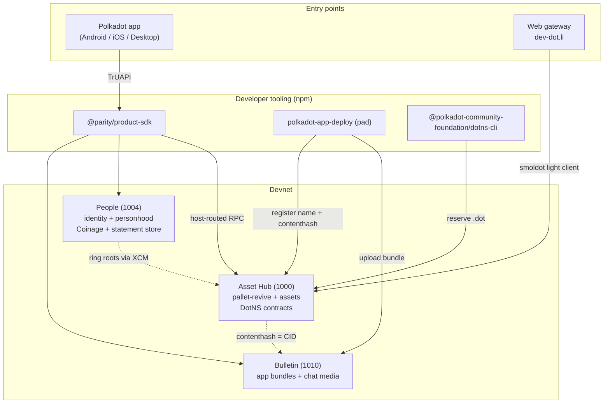

# Architecture overview

On the Polkadot Products Devnet, web apps are named, published and opened
through Polkadot infrastructure. People open them in the Polkadot app or
through the web gateway at [dev-dot.li](https://dev-dot.li). Either way, the
app runs on the user's device in a sandboxed container.

This page follows one request, a user opening a `.dot` app, from the name to
chain storage and back. Each subsystem has its own page with the details.

## The pieces

- The network: a community-operated [Paseo](network.md) relay chain plus
  system parachains. App developers target Asset Hub (para 1000), which runs
  `pallet-revive` (PolkaVM/EVM contracts, chain id `420420417`), the
  `pallet-assets` suite and the DotNS gateway pallet. Identity lives on the
  People chain (para 1004). Web-app bundles live on the Bulletin chain
  (para 1010).
- The client tier: three native [Polkadot app](client.md) clients (Android,
  iOS, Desktop/Web). They hold keys on the device and host dApps in a sandboxed
  webview, talking to them over a shared protocol, TrUAPI.
- Naming: [DotNS](naming.md), a set of PolkaVM contracts that turn a `.dot`
  domain into an owner, a resolver and a content hash.
- App delivery: the [`pad` CLI](app-delivery.md) uploads a static bundle to
  Bulletin and binds its CID to a `.dot` domain. The
  [dotli gateway](app-delivery.md) resolves and renders it.
- Storage & data: one content-addressed [Bulletin store](storage.md) holds both
  app bundles and app runtime data (through Cloud Storage). Writes need an
  authorization, and reads are open.
- Smart contracts: [contracts](contracts.md) are PolkaVM bytecode running on
  `pallet-revive` on Asset Hub.
- Identity & personhood: [proof-of-personhood](identity.md) tiers (Lite and
  Full) and a precompile any contract can read.
- Money: [CASH](money.md), a devnet "digital dollar" spent through the
  privacy-preserving Coinage system on the People chain.
- Discovery: [Browse](discovery.md), an on-chain publisher registry of
  listable apps.
- Messaging: [chat and calls](messaging.md) carried over the People-chain
  statement store, with media on Bulletin and WebRTC for calls.

## System diagram

## Request path: opening a `.dot` app

Take a user opening `calculator.dot`. The steps are much the same on the web
gateway and in the app's browser. What differs is who you have to trust.

1. Address to label. On the web, the user visits
   `https://calculator.dev-dot.li`, and the dotli host takes the registrable
   root and the label `calculator` from the subdomain. In the app, the user
   types `calculator.dot` into the browser bar.
2. Name to content hash. The client computes the ENS-style namehash of
   `calculator.dot` (`keccak256(DOT_NODE, keccak256("calculator"))`) and reads
   `contenthash(node)` from the DotNS ContentResolver contract on Asset Hub.
   The web gateway does this without trusting a server: it reads contract
   storage directly through an in-browser smoldot light client, so there is no
   RPC server in the path.
3. Content hash to CID. The `contenthash` bytes (`0xe301` + CIDv1) decode to an
   IPFS CID that points at the app bundle.
4. Fetch the bundle. The content comes from the Bulletin chain (through smoldot
   `bitswap_v1_get`, shown as verified) or from an IPFS gateway. A directory
   arrives as a CAR archive, which is parsed into a file map and served by a
   Service Worker virtual filesystem.
5. Render in a sandbox. The bundle runs inside a sandboxed iframe (web) or a
   platform webview (app). The host opens a TrUAPI channel to it. The gateway
   runs the TrUAPI core (`@parity/truapi-host`) in a Web Worker and hands the
   iframe a `MessagePort`, and the native apps run the same core. The
   Product's TrUAPI client (`@parity/truapi`, used by the Product SDK) talks
   over that channel.
6. App talks to the host. Over TrUAPI the dApp asks for accounts, permissions,
   signatures and chain connections. All chain RPC goes through the host
   container (the Product SDK is built to run inside it), so the app never
   manages its own node connections or keys. Keys on the device sign, and the
   user approves each signature in a native modal.

From here the running app draws on the rest of the platform: it calls
[contracts](contracts.md) on Asset Hub, reads a caller's
[personhood tier](identity.md) from the precompile at `0x…0a010000`, or moves
[CASH](money.md). Messaging and calls run over the same
[People-chain statement store](messaging.md) the app already uses.

## Where to go next

- New here? Start with [Get started as a developer](../getting-started/developers.md).
- Building an app? Read [App delivery](app-delivery.md), then
  [Build & publish an app](../guides/build-and-publish.md).
- Looking for addresses and endpoints? See [Reference](../reference/index.md).
