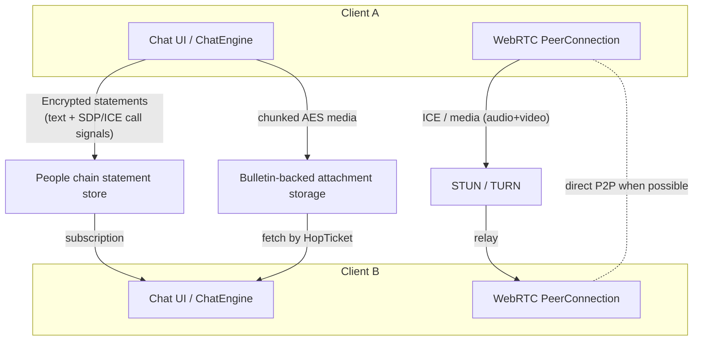

# Messaging & calls

The Polkadot app has encrypted chat and one-to-one voice and video calls, with
no dedicated messaging or signaling server. Text messages and call-setup
signals travel over the same on-chain channel. Media attachments are stored on
a separate content chain, and live audio and video flow peer to peer over
WebRTC. This page shows how those pieces fit together and what users and
Product developers should expect.

## Transport: the statement store

Text messages are not stored on a server, and they are not sent directly
between devices either. Each message is encrypted on the sending device and
published to the statement store on the People chain. Recipients subscribe to
that store and decrypt messages on their own device.

The same channel carries text, reactions, replies, contact events and call
setup signals. That shared transport is why chat and calls live in the same
part of the app.

### Encryption

Messages are encrypted per peer, not with one global key. Only encrypted
statements are submitted to the store, so the People chain only sees
ciphertext.

## Media attachments: the Bulletin "hop"

Images, video and files do not go through the statement store. Attachments are
encrypted and uploaded through Bulletin-backed storage, and the chat message
carries a reference that lets the recipient fetch and decrypt the file.
[The network](network.md) has more on Bulletin storage.

## Voice and video calls

Calls use WebRTC, with no dedicated signaling server. The offer, answer,
connection candidates and call-close signals are sent as encrypted chat
messages over the statement store. Once the peers connect, media flows directly
when possible, or through TURN when a relay is needed.

### NAT traversal (STUN and TURN)

When a direct WebRTC path is not available, clients can use temporary TURN
credentials. Platform infrastructure provides those credentials and they are
short-lived, so Product apps should treat calling as a service the host
provides and not embed TURN configuration themselves.

## Data paths at a glance

## Desktop and device sync

Voice and video calls are mobile-only today. The desktop build has no call UI
and cannot start or answer calls. Desktop uses WebRTC only for device sync and
peer-to-peer chat. It shares the same broad building blocks for chat and sync,
but calling stays on the mobile app.

## Common blockers

- A message appears delayed: the sender and recipient both depend on the
  statement store subscription and on decrypting locally.
- An attachment does not open: the encrypted attachment reference may arrive
  before the content is available from Bulletin-backed storage.
- A call only connects through a relay: that is expected on some networks.
  TURN credentials come from the platform and can change.
- You want to call from desktop: calling is mobile-only today, and the desktop
  build has no call UI. Use the mobile app to start or answer calls.

## Learn more

- [Polkadot Android](https://github.com/Polkadot-Community-Foundation/polkadot-android-community): source for the chat engine and call stack
- [Messaging & calls](../guides/messaging-and-calls.md): how to chat and call in the app
