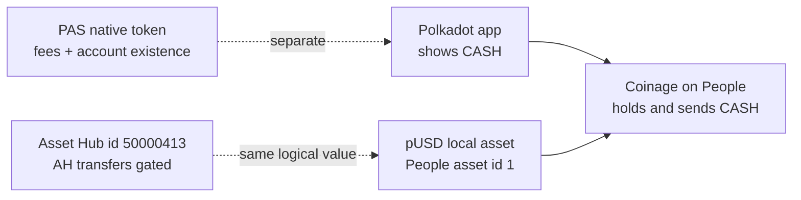

# Money: CASH & funding

How money works on the Polkadot Products Devnet: what CASH is in the app, why
it is different from the native token used for fees, and how funds move when
people use the app.

## Two balances

Users see CASH in the Polkadot app. CASH is the app's name for a devnet
digital-dollar asset. It is the balance users top up, earn and send to other
people inside the app.

The chains also have a native token, PAS, used for fees and for account
existential deposits on Paseo-based chains. CASH and PAS are separate:

- CASH is the spendable app balance.
- PAS is the native network token used for fees.
- Both are devnet-only and have no real value.

Keep this in mind when something goes wrong. A user can have CASH for app
payments and still need a small amount of PAS for network fees or to keep the
account in existence.

## Where CASH lives

CASH is built on the Polkadot asset stack, and the Polkadot app uses it through
the People chain. On People, the balance is a local pUSD asset (asset id `1`)
that Coinage denominates and shows as CASH. The same logical value is also
represented on Asset Hub, with id `50000413`. That is a protected asset, and
transfers of it on Asset Hub are gated.

Day to day, people don't need to move assets between chains by hand. The app
shows CASH as a single balance and does the chain-specific work for them.

## How CASH is held

The app does not treat CASH like a simple account balance. It holds and spends
CASH through Coinage, a People-chain system that represents value as coins.
When a user sends CASH, the app prepares and submits a Coinage transfer, not a
plain token transfer.

This matters for developers: payment flows in your app should use the platform
services that the host and SDK provide. A Product should not try to rebuild the
wallet, key handling or low-level payment flow.

## How users get CASH

Users get CASH inside the Polkadot app, in two ways:

1. Top up in the app. Devnet builds can offer a top-up action that funds the
   account and brings value into the CASH balance.
2. Earn rewards. Some app and personhood flows can reward users with value that
   then shows up as CASH.

Once onboarding completes, the balance in the user's Pocket updates and they
can spend it.

## Sending CASH

Sending CASH goes through the wallet:

1. The user chooses a recipient and amount in the Polkadot app.
2. The app prepares the Coinage transfer.
3. The user approves the action on the device.
4. The app submits the transaction and waits for it to settle.

## What developers should rely on

Treat CASH as a platform service that the host and SDK provide:

- Ask the host for the user's account and permissions.
- Use the SDK and host-provided payment and chain APIs.
- Let the Polkadot app handle signing and key custody.
- Show amounts clearly as devnet value.

Don't hardcode operator accounts, funding assumptions or private chain
configuration into an app. The Devnet operators supply the network presets,
live endpoints and registry addresses.

## Learn more

- [`pallet-coinage`](https://github.com/paritytech/individuality-community/blob/main/pallets/coinage/src/lib.rs): the source, showing how CASH is represented as coins, held and transferred
- [paseo-network/runtimes](https://github.com/paseo-network/runtimes): the chain runtimes and asset definitions
- [Get & use CASH](../guides/get-and-use-cash.md): get and send CASH yourself
