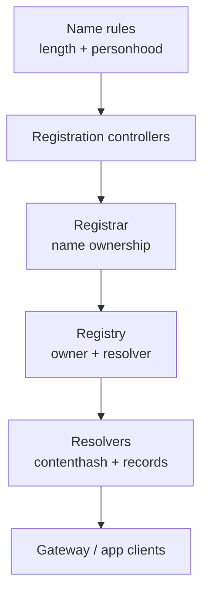

# Naming: DotNS

DotNS is the `.dot` naming system for the Polkadot Products Devnet. Every
gateway, client and directory app needs it to answer one question: given a name
like `calculator.dot`, what does it point to, and who is allowed to change it?
This page covers ownership, records, resolution and the personhood rules for
names.

DotNS is a set of PolkaVM contracts, used by the DotNS CLI, the web gateway and
Product tooling. Names are on-chain records, so when a record changes, every
client that resolves the name sees the new target.

## The name model

Each `.dot` domain has two important pieces of state:

- Owner: the account or contract that controls the name.
- Resolver records: the data attached to the name, including the content hash
  that points to an app bundle.

Internally, DotNS hashes names into fixed-width identifiers so contracts can
look them up efficiently. You normally don't calculate those hashes yourself:
the CLI, SDK, gateway and host tooling do it.

## Resolving `name.dot` to an app bundle

Resolution only reads. A client never needs a naming server: it computes the
node locally and reads two contracts.

1. Form `domain = <label>.dot` and compute `node = namehash(domain)`.
2. Read `DotnsRegistry.recordExists(node)` and `DotnsRegistry.owner(node)`. If
   the record does not exist or the owner is the zero address, resolution stops
   with an empty result.
3. Read `DotnsContentResolver.contenthash(node)`, which returns the ENS-style
   contenthash bytes for the name.
4. Decode those bytes to an IPFS CID.
5. Fetch the application bundle from the gateway.

The web gateway at [dev-dot.li](https://dev-dot.li) follows the same path and
renders the resolved bundle in a sandboxed frame.
[App delivery](./app-delivery.md) covers how the content is uploaded and how
the contenthash gets written.

Because resolution is a plain contract read, you can check any name yourself
with the DotNS CLI: `dotns content view <name> --env devnet`.

## Contract topology

DotNS splits ownership, records and control into separate contracts. That way
parts of the protocol can be replaced without changing the basic model that
clients depend on.

- Registrar: records who owns a `.dot` domain.
- Registry: connects the name to its resolver.
- Resolvers: hold the records that clients read, including the content hash
  for an app bundle.
- Name rules: decide which names are open, which are reserved and which need
  personhood.

## Registration

The public registration path is a two-phase commit-reveal, which stops anyone
from front-running a name you chose. The CLI takes you through it:

1. Validate and normalise the label (a single lowercase DNS label, at least 3
   characters long; shorter labels revert with `LabelTooShort`).
2. Classify and price the label through `PopRules`, and check whether it is
   reserved.
3. Commit to the name without revealing the full registration.
4. Wait for the commitment window.
5. Reveal the registration, mint the name and write its initial records.

Names can also be transferred (the ERC-721 token moves), and the owner of a
base name can create subnames with `setSubnodeOwner`.

## Reserved and short-name gating

Not every label is available on the public path. `PopRules` classifies each
label by the length of its stem (the label with any trailing digits stripped)
and gates it accordingly:

| Tier | Condition | Effect |
| --- | --- | --- |
| Reserved | stem ≤ 5 characters | short names are gated |
| PopLite | stem 6–8, exactly 2 trailing digits | lite personhood username |
| PopFull | stem 6–8, no trailing digits | full personhood username |
| NoStatus | stem ≥ 9 characters | open, deposit-backed |

Labels with 1 or more than 2 trailing digits are rejected. Governance-reserved
and name-reserved labels revert on the public controller. A separate
owner-managed whitelist (`registerReserved`) can bypass PoP pricing for
specific addresses.

Personhood-gated names come through a controlled path tied to the personhood
system, not the public commit-reveal path. Product developers normally deal
with this through the app, the CLI or DotNS services, not by calling those
contracts directly.

## Learn more

- [dotns](https://github.com/paritytech/dotns): the contracts
- [dotns-sdk](https://github.com/paritytech/dotns-sdk): the CLI and reference UI
- [Register a .dot domain](../guides/register-a-dot-name.md): register one yourself
