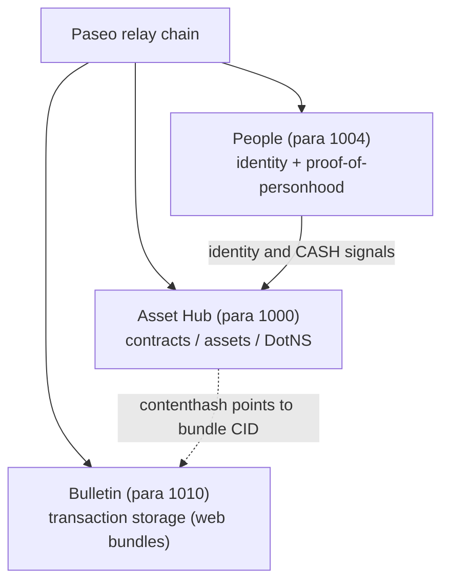
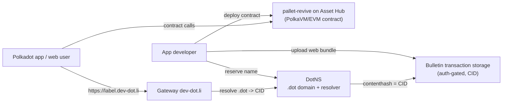

# The network

The Polkadot Products Devnet runs on the community-operated Paseo network: a
Paseo relay chain plus a set of system parachains. Apps are built against three
of those chains: Asset Hub, People and Bulletin. This page shows what each chain
does, and how they work together when a Product is deployed and opened.

## Topology

The relay chain is the root of trust. Product flows mostly touch three system
parachains: Asset Hub for contracts and assets, People for identity and money
flows, and Bulletin for web-app bundle storage.

| Chain | Para ID | Role |
| --- | --- | --- |
| Relay | — | Root of trust; anchors the system parachains |
| Asset Hub | 1000 | Contracts (PolkaVM/EVM), assets, DotNS gateway |
| People | 1004 | Identity and proof-of-personhood |
| Bulletin | 1010 | Web-app content storage |

## Asset Hub para 1000

Asset Hub is the main chain for Product developers. It runs the contracts,
assets and naming that deployed apps use.

**pallet-revive**
The PolkaVM smart-contract environment. DotNS and application contracts run here.

**Assets + ERC-20 precompiles**
On-chain assets available to contracts through ERC-20-style precompiles, so contracts can read and transfer supported assets without dealing with Substrate storage.

**DotNS gateway**
Connects `.dot` domains to the contract environment. See [Naming](./naming.md) for how names resolve to app bundles.

**Personhood precompile**
Contracts read a user's personhood tier through a precompile, without calling the identity backend.

## People para 1004

The People chain holds identity, proof-of-personhood and Coinage state.
Usernames are attested here, personhood status is recorded here, and CASH is
held and sent here through Coinage.

## Bulletin para 1010

The Bulletin chain stores published web-app bundles that the gateway serves.

Bulletin uploads work by authorization, not by fees. Instead of charging
tokens per upload, an authorizer (Root, sibling parachains, or registered
authorizers) decides who can store data. That is why publishing an app bundle
does not cost devnet tokens.

## The deployments register

Addresses, endpoints and CIDs are network-specific. They change when a network
is redeployed, so nothing in the platform hard-codes them. Instead, each
command-line tool selects a network preset (`--env devnet` for `pad` and
`dotns`), and the preset carries the endpoints and address book for that
network.

The addresses themselves are in
[Addresses & registries](../reference/addresses.md).

## Deploy and serve flow

Here is how the three chains work together over an app's life:

A developer deploys contracts to Asset Hub through `pallet-revive`, reserves a
`.dot` name through the DotNS gateway and uploads the web bundle to Bulletin.
The name's contenthash resolver is bound to the bundle's CID, and the gateway
at [https://dev-dot.li](https://dev-dot.li) serves the app at
`https://<label>.dev-dot.li`. The [contracts](./contracts.md) and
[naming](./naming.md) pages, and the [developer guides](../guides/index.md),
go into more detail.

## Learn more

- [paseo-network/runtimes](https://github.com/paseo-network/runtimes): the chain runtimes
- [pallet-revive](https://github.com/paritytech/polkadot-sdk/tree/master/substrate/frame/revive): the PolkaVM contract environment
