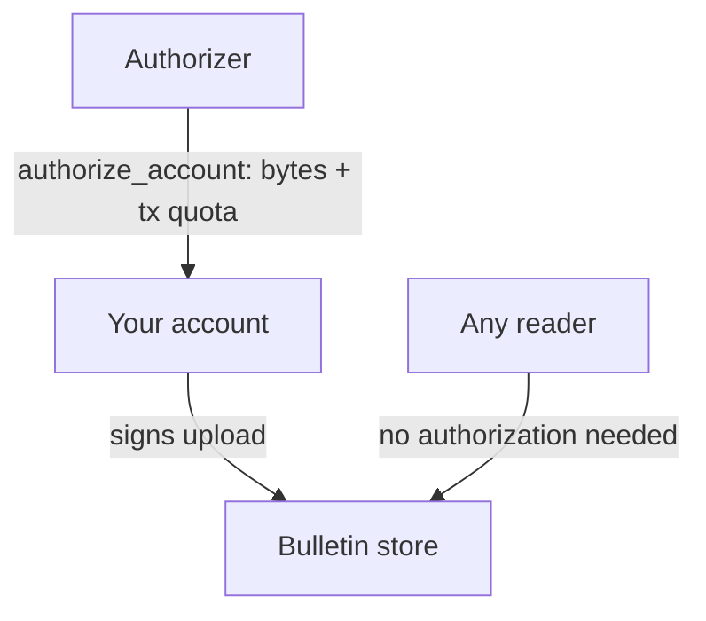

# Storage & data

Apps on the Polkadot Products Devnet keep their data in one place: the Bulletin
chain (para 1010), a content-addressed on-chain store. It is how an app is
meant to persist data. You give it bytes and get back a content identifier
(CID), and anyone can read those bytes back by CID. Because content is
addressed by its own hash, the same bytes always give the same CID, and the
client can verify what it fetched.

Bulletin holds two kinds of content:

- App bundles: the static frontend a developer publishes. The `pad` CLI uploads
  the build and binds its CID to a `.dot` name. This is the write side of
  [app delivery](app-delivery.md).
- App data: anything a running app stores (documents, media, records). Apps
  reach it through the host's Cloud Storage service, not by talking to the
  chain directly.

## Cloud Storage: storing app data

When an app needs to persist data, it uses Cloud Storage: content-addressed
storage backed by Bulletin, available through TrUAPI and the
[Product SDK](../guides/platform-services-sdk.md#store-and-retrieve-data-cloud-storage).
The API is small: upload bytes, get a CID, fetch by CID.

```ts
const cloud = app.cloudStorage;          // null if the service is disabled
const uploaded = await cloud.upload(bytes);   // -> Result<CID>
if (uploaded.ok) {
  const back = await cloud.fetch(uploaded.value); // -> Result<Uint8Array>
}
```

Know these before you design around it:

- It is content-addressed, not a key-value store. You get back a CID for
  exactly the bytes you stored, and there is no "path" you can overwrite. To
  model state that changes, store the new version and keep the CID that points
  to it (for example in a `.dot` record, a contract, or another Cloud Storage
  object).
- Reads are open and writes are authorized. Anyone can fetch a CID. Uploading
  needs a connected account with a storage authorization (see below).
- Reads only work inside a container. The client fetches through the
  host/light-client path, and there is no public IPFS-gateway fallback.
- Pick the right network. `cloudStorage.environment` must be `devnet` for this
  network. It defaults to `paseo`, a different chain, and nothing errors if you
  get it wrong: your data is written somewhere you did not expect.

The [Product SDK guide](../guides/platform-services-sdk.md#store-and-retrieve-data-cloud-storage)
has the API details and the `Result` pattern.

## How storage authorization works

Bulletin storage works by authorization, not by fees. You don't pay a token fee
per upload. Instead, the uploading account must hold a live authorization: an
on-chain quota of bytes and transactions granted by an authorizer. Reading
never needs one. Authorization limits storing, not retrieval.



The account that signs an upload is the account that spends the quota, so that
is the account to authorize. For publishing, it is the account that owns your
`.dot` name. For Cloud Storage, it is the connected user account.

Writes are gated because an unmetered public store invites spam. In production,
the write gate is typically tied to proof of personhood or to an operator-run
authorizer. This Devnet leaves it open on purpose: a public Storage Faucet and
a shared authorizer let any developer get an allowance without a personhood
check. Grant one from the Faucet tab of the
[Bulletin Chain Console](https://paritytech.github.io/polkadot-bulletin-chain/)
(select the **Products Devnet** network). The steps for publishing are in
[Get storage authorization](../guides/build-and-publish.md#get-storage-authorization).

Authorizations are finite and expire. Each one is a limited quota with an
expiry date, and the Console lists current authorizations and when each one
lapses. If a deploy or upload that used to work suddenly stops at the storage
step, the allowance has most likely run out or expired. Grant it again and
retry. Content that is already stored is not affected: the limit only applies
to new writes.

## Learn more

- [App delivery](app-delivery.md): publishing an app bundle to Bulletin and
  binding it to a `.dot` name
- [Store and retrieve data (Cloud Storage)](../guides/platform-services-sdk.md#store-and-retrieve-data-cloud-storage): the SDK API, in code
- [Get storage authorization](../guides/build-and-publish.md#get-storage-authorization): grant an allowance and publish
- [polkadot-bulletin-chain](https://github.com/paritytech/polkadot-bulletin-chain): the storage pallet and quota model
