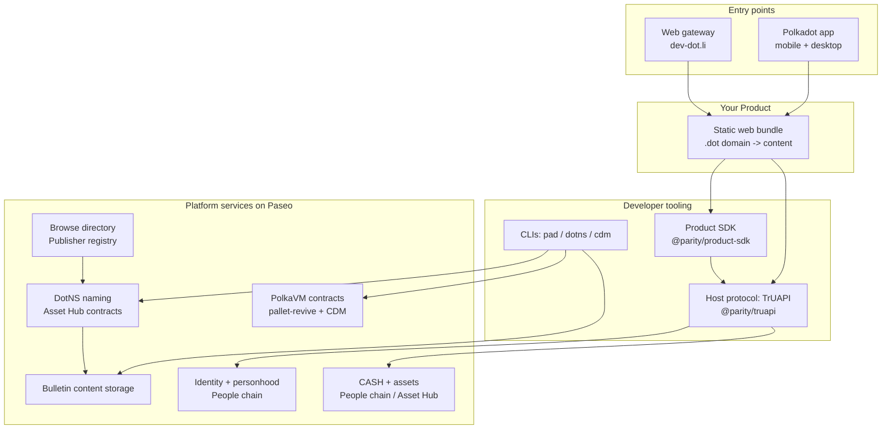

# Get started as a developer

On the Polkadot Products Devnet, an app is a static website with a `.dot` name.
You build it, publish it to the Devnet, and people open it in the Polkadot app
or in a browser. This page takes you from installing the tools to a live app.

## What you are building

These docs call a published app a Product. It is a static web app: HTML, CSS
and JavaScript. There is no app store, no backend for you to run and no server
between your users and your app.

A Product runs inside a host: the Polkadot app (mobile or desktop) or the web
gateway at [dev-dot.li](https://dev-dot.li). The host provides the wallet, the
signing prompts, storage and chain access. Your app talks to the host over a
protocol called TrUAPI, so the same code runs on mobile, desktop and the web,
and your users never have to handle raw keys or RPC endpoints.

To publish, you upload the bundle to the Devnet and point a `.dot` domain at
it. The name then resolves to your bundle wherever someone opens it.

## How the pieces fit



The Polkadot app keeps keys on the device, runs each Product in a sandbox and
speaks TrUAPI to it. You use the SDK in your app code, and the CLIs to name,
publish and deploy. The services on the chains handle naming, storage,
identity, money, contracts and discovery.

When you get stuck, first work out which of these layers the problem is in. The
[architecture overview](../architecture/index.md) explains each one, and
follows a request from a `.dot` name to chain storage and back.

## Before you start

You run every command below through the CLIs from
[step 1](#1-install-the-tooling), and you sign with one account. If you don't
have a key yet, [step 4](#4-set-up-an-account-and-register-a-dot-domain) shows
how to create a throwaway one (no seed to import, no password).

Before a command can touch the chain, that account must be:

1. Funded with native tokens on Asset Hub, to pay fees. Use the
   [faucet](../reference/networks.md#faucet).
2. Mapped to its EVM address. Do this once with
   `dotns account map --env devnet`. Every CLI here signs PolkaVM transactions
   on Asset Hub, and an unmapped account fails on the first one.
3. Authorized to write to Bulletin, so step 5 can upload your bundle. See
   [Get storage authorization](../guides/build-and-publish.md#get-storage-authorization).

The CLIs don't share a keystore. `dotns` keeps its own (step 4) and `pad` takes
`--mnemonic` on the command line. Both can use the same account.

## 1. Install the tooling

--8<-- "install-clis.md"

Your app code also needs the SDK, at the version the hosts speak (see
[Packages & tools](../reference/packages.md#install-the-sdk-version-the-hosts-speak)):

```bash
npm i @parity/product-sdk@0.39.0
```

## 2. Choose a network preset

Every CLI takes the network as a flag. For this Devnet it is `devnet`:
`--env devnet` for `pad` and `dotns`, and `-n devnet` for `cdm`.

!!! warning "Always pass the flag"
    The same binaries ship `paseo` and `paseo-next` presets pointing at other
    networks, and the default is not `devnet`. Omit the flag and your app lands
    on a different chain, where nothing on this Devnet can see it.

## 3. Build a web app with the Product SDK

The Product SDK (`@parity/product-sdk`) gives your app typed access to the
host: wallet, storage, chain calls, contracts and identity.

```ts
import { createApp } from "@parity/product-sdk";

const app = await createApp({
  cloudStorage: { environment: "devnet" }, // defaults to paseo
});

const result = await app.cloudStorage!.upload("hello world");
if (result.ok) console.log(result.value); // the CID
```

This code only works inside a host. Outside the Polkadot app or the web
gateway, `createApp()` itself throws
`createApp requires a host product context`. Start from the
[playground-app-template](https://github.com/Polkadot-Community-Foundation/playground-app-template),
which is already on the SDK version the hosts speak. For automated tests, use
the test host in `@parity/truapi-host`, described in
[Use platform services from the SDK](../guides/platform-services-sdk.md#test-without-the-real-host).

Build your app to a static directory. The template uses `vite build`, which
writes to `dist/`.

### Build with Claude Code

The product-sdk repo is also a
[Claude Code plugin marketplace](https://github.com/paritytech/product-sdk#claude-code-plugin).
Its skills teach Claude Code the whole SDK: app scaffolding, chain connections,
transactions, contracts, cloud storage, statement store, individuality,
utilities, and migrating an existing codebase. Install it, then ask "build me a
Polkadot app":

```
/plugin marketplace add paritytech/product-sdk
/plugin install product-sdk@paritytech
/reload-plugins
```

Each skill is a plain Markdown file under
[`product-sdk/skills/`](https://github.com/paritytech/product-sdk/tree/main/product-sdk/skills),
so other agents and editors can read them as reference too.

The skills follow the SDK's `main` branch, which is already past 0.39.0. Tell
the agent to keep `@parity/product-sdk@0.39.0`, and check an API against that
version when a skill and the installed package disagree.

## 4. Set up an account and register a `.dot` domain

Your deploy account must own the `.dot` domain before you can publish to it.
This is a CLI signing key, separate from any account in the Polkadot app.

--8<-- "throwaway-account.md"

To reuse an account across sessions, store a mnemonic or key-uri in the
encrypted `dotns` keystore instead of the environment:

```bash
dotns auth set          # choose `mnemonic`, paste it, then set a password
dotns account address   # confirm the active account
```

Every later command then needs the keystore password. Export
`DOTNS_KEYSTORE_PASSWORD` to avoid an interactive prompt. See
[Register a `.dot` domain](../guides/register-a-dot-name.md#set-up-an-account)
for details.

Fund, map and authorize the account as listed in
[Before you start](#before-you-start). Then, with `$MNEMONIC` exported,
register your name:

```bash
dotns register domain --name my-cool-app --env devnet
```

Pick a label whose stem (the label without any trailing digits) is nine
characters or longer. Shorter ones are gated behind proof of personhood. Registration is a
commit-reveal flow that takes a few minutes, so check that it landed before you
move on:

```bash
dotns lookup owner-of my-cool-app --env devnet
```

[Register a `.dot` domain](../guides/register-a-dot-name.md) has the full rules.

## 5. Publish the bundle with `pad`

`pad` uploads your static build and points the `.dot` domain at it. It does not
read the dotns keystore, so give it the signer that owns the name:

```bash
pad ./dist my-cool-app.dot --env devnet --mnemonic "$MNEMONIC"
```

That account must own the name and hold a Bulletin storage authorization. A
successful run ends with `Verified on-chain:` and the published CID.

Your app is now live as `my-cool-app.dot` in the Polkadot app and at
`https://my-cool-app.dev-dot.li` on the gateway. To give it a name, description
and icon in the directory, add a product config. See
[Add card metadata](../guides/build-and-publish.md#add-card-metadata).

To also list it in Browse, add `--publish`. That step needs proof of personhood,
which today comes from the Polkadot app rather than the CLI; without it the
deploy still succeeds and the app simply is not listed. See
[List your app in Browse](../guides/list-in-browse.md).

## 6. Deploy contracts with `cdm` (optional)

Smart contracts on this Devnet are PolkaVM contracts on Asset Hub. The Contract
Dependency Manager (`cdm`) builds and deploys them, publishes their metadata,
and registers their addresses so other apps can find a contract by name.

`cdm` needs a Rust toolchain that `npm i -g` does not install, so run
`cdm setup` first. [Deploy & register contracts](../guides/deploy-contracts-cdm.md)
has the full sequence.

## Next steps

Each step above has a full guide under the **Guides** tab:

<div class="grid cards" markdown>

-   **[Build & publish an app](../guides/build-and-publish.md)**

    ---

    Bundle, name, deploy and card metadata.

-   **[Register a `.dot` domain](../guides/register-a-dot-name.md)**

    ---

    Account setup, name rules and the commit-reveal flow.

-   **[Deploy & register contracts](../guides/deploy-contracts-cdm.md)**

    ---

    Build, deploy and register PolkaVM contracts with `cdm`.

-   **[Use platform services from the SDK](../guides/platform-services-sdk.md)**

    ---

    Chains, storage, contracts and identity from your app.

-   **[List your app in Browse](../guides/list-in-browse.md)**

    ---

    Get your Product into the in-app directory.

</div>

To see finished Products, open [Calculator](https://calculator.dev-dot.li) or
[Stopwatch](https://stopwatch.dev-dot.li). The full list of reference apps is
in [More resources](../reference/resources.md).

To try your own app as a user, install the Polkadot app and fund an account.
See [Create an account & get funds](../guides/create-account.md).
